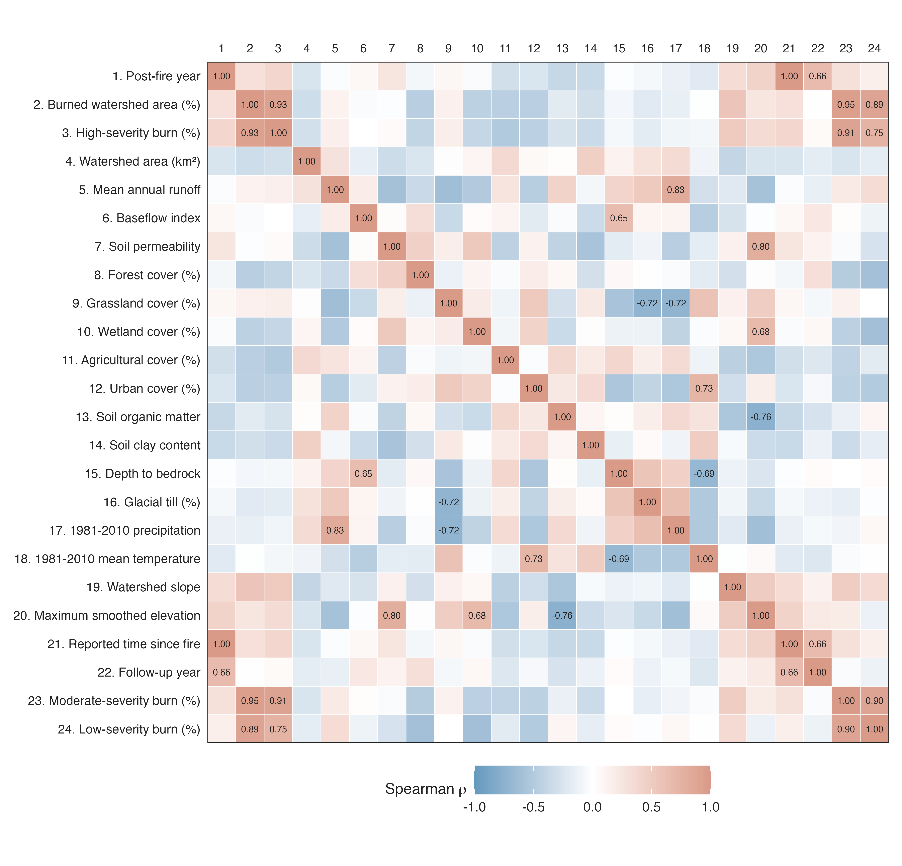
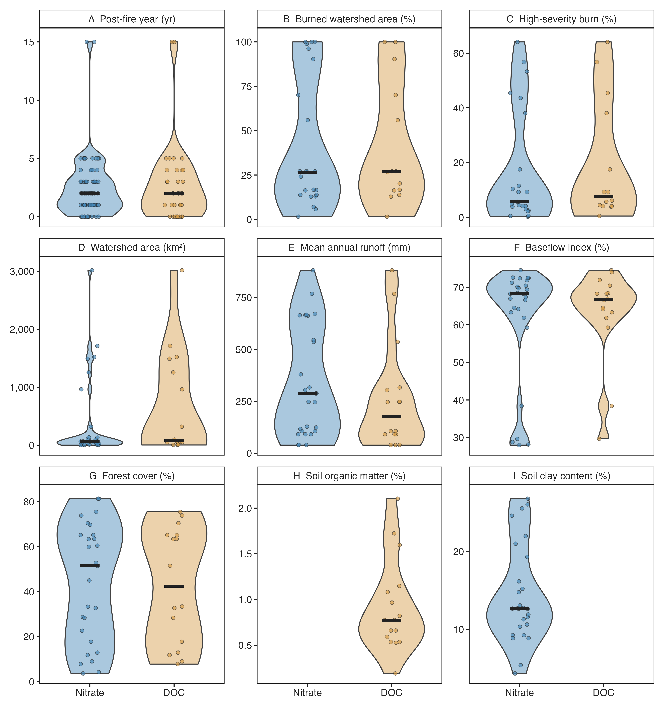
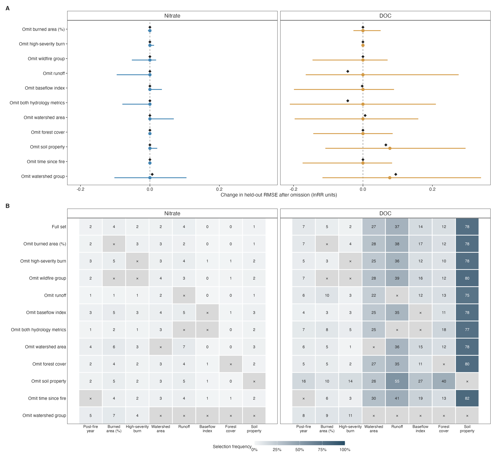

# Supporting information for statistical analyses

This supporting information accompanies Results Sections 3.1–3.3. Section S1 reports pooled wildfire responses and their dependence, interpolation, and influence sensitivities. Section S2 reports predictor definitions, cross-validation performance, publication-specific errors, and conditional uncertainty in predictive improvement. Section S3 reports predictor-selection stability, coefficient distributions, alternative weighting, and structured predictor omissions.

## S1 Pooled wildfire responses

### Analysis inventory and annual effect sizes

The analysis includes 12 publications, 14 unique wildfires, 28 approved burned–reference watershed pairs, and 46 study-specific physical watersheds. The retained dataset contains 35 DOC and 68 nitrate annual responses. Shared reference watersheds are counted once within each publication and role; pair counts therefore exceed reference-watershed counts. Six annual records with only one eligible matched date were excluded. One additional nitrate record from Crandall et al. (2021), Site_2–Control_2 in 2018, was excluded after inspection because of its extreme response (lnRR −4.507). This was a post hoc response-based decision, not a confirmed measurement error; its DOC counterpart was retained. Table S1 describes the retained publication inventory.

Annual lnRR is the natural logarithm of the ratio of burned and reference arithmetic-mean concentrations calculated over the same dates within a calendar year. Dates must have finite, strictly positive concentrations in both watersheds. Measured concentrations are preserved. Daily linear interpolation is restricted to observed endpoints separated by no more than 40 elapsed days, without extrapolation across longer gaps. Calendar-year means summarize available matched dates rather than complete annual concentration or discharge-weighted records.

### Table S1 Retained publication inventory

| Publication | DOC records | Nitrate records | Pairs | Fires within publication | Burned watersheds | Reference watersheds |
| --- | --- | --- | --- | --- | --- | --- |
| Coombs & Melack; 2013 | 0 | 6 | 3 | 1 | 3 | 1 |
| Crandall et al. 2021 | 3 | 2 | 3 | 1 | 3 | 3 |
| Gerla & Galloway; 1998 | 0 | 5 | 1 | 1 | 1 | 1 |
| Gluns & Toews; 1989 | 0 | 8 | 2 | 1 | 2 | 1 |
| Hauer & Spencer 1998 | 0 | 15 | 5 | 1 | 5 | 3 |
| Hickenbottom et al. 2023 | 2 | 2 | 2 | 2 | 2 | 2 |
| Mast & Clow; 2008 | 4 | 4 | 1 | 1 | 1 | 1 |
| Murphy et al. 2018 | 15 | 15 | 3 | 1 | 3 | 1 |
| Oliver et al. 2012 | 0 | 2 | 1 | 1 | 1 | 1 |
| Rhea et al. 2021 | 3 | 3 | 3 | 2 | 3 | 2 |
| Uzun et al. 2020 | 4 | 4 | 2 | 2 | 2 | 1 |
| Writer et al. 2014 | 4 | 2 | 2 | 1 | 2 | 1 |

There are 15 publication–fire records but 14 unique wildfires because Rhea and Writer both include High Park. Watershed totals are study-specific physical-site counts.

[Full-precision Table S1](tables/table_s1.csv).

### Balance weights and dependence groups

For an analyte with S publications, Pₛ eligible pairs in publication s, and Yₛₚ retained annual responses in pair p, the normalized weight of each annual response is wₛₚᵧ = 1/(S × Pₛ × Yₛₚ). Equivalently, annual responses are averaged within pairs, pair means within publications, and publication means across publications. The weighted intercept-only linear model yields this pooled lnRR. Weights are recalculated for each response inventory and are not inverse sampling-variance weights. Exponentiating the pooled lnRR gives a geometric summary of burned-to-reference response ratios, rather than a ratio of grand mean concentrations.

Uncertainty uses CR2 cluster-robust covariance estimates and Satterthwaite degrees of freedom. The working target for the correction is the identity matrix, with fitting weights explicitly treated as nonprecision weights. Within-group covariance is not estimated as a complete sampling covariance matrix. Publications linked directly or indirectly through any included wildfire form connected dependence groups; all observations from a publication remain together, including publications covering multiple fires. Rhea and Writer connect through High Park, producing six DOC groups from seven publications and eleven nitrate groups from twelve publications. Different groups are assumed independent. These links are working dependence assignments and do not imply that different publications measured the same physical watersheds. Small-sample adjustment does not eliminate the limitations of having few groups (Hedges et al., 2010; Tipton, 2015; Pustejovsky and Tipton, 2022).

### Sensitivity to the clustering definition

We recalculated CR2 intervals using publication identifiers as clusters. The analysis rows, weights, and pooled estimates were identical to those in the connected-group analysis. This comparison changes estimated uncertainty, not the point estimate. Nitrate intervals remained above zero under both definitions; DOC intervals included zero under both definitions (Table S2).

### Table S2 Pooled responses under alternative clustering definitions

| Analyte | Clustering | Records | Publications | Groups | Pooled lnRR [95% CI] | Satterthwaite df |
| --- | --- | --- | --- | --- | --- | --- |
| DOC | Publication | 35 | 7 | 7 | 0.295 [−0.020, 0.611] | 4.98 |
| DOC | Connected publication–fire group | 35 | 7 | 6 | 0.295 [−0.098, 0.689] | 3.80 |
| Nitrate | Publication | 68 | 12 | 12 | 1.119 [0.711, 1.527] | 8.12 |
| Nitrate | Connected publication–fire group | 68 | 12 | 11 | 1.119 [0.653, 1.585] | 6.37 |

Connected publication–fire groups define primary uncertainty. Weights and estimates are identical between clustering definitions.

[Full-precision Table S2](tables/table_s2.csv).

### Sensitivity to interpolation on matched inventories

Observed-only responses were recomputed using dates when both watershed concentrations were measured and positive, with at least two such matched dates per pair–analyte–year. This retains 32 DOC and 56 nitrate responses, compared with 35 and 68 in the primary analysis. The 15 omitted annual records remain in the primary analysis. The interpolation-based comparison was restricted to exactly the same pair–analyte–year keys as observed-only, with balance weights recomputed in each inventory. Both use connected-group CR2 intervals. The direct observed-only versus matched-interpolated comparison holds annual-record membership fixed; a comparison with the primary inventory also reflects removal of sparsely observed records.

On the matched inventory, observed-only minus interpolation-based pooled lnRR was 0.025 for DOC and −0.028 for nitrate. DOC intervals included zero and nitrate intervals remained above zero for both response constructions (Table S3). This comparison assesses sensitivity to interpolation and sampling support; it does not establish which construction most accurately represents the true annual mean.

### Table S3 Interpolation and annual record inventory comparisons

| Analyte | Response inventory | Records | Publications | Groups | Pooled lnRR [95% CI] |
| --- | --- | --- | --- | --- | --- |
| DOC | Primary interpolation inventory | 35 | 7 | 6 | 0.295 [−0.098, 0.689] |
| DOC | Observed only, matched inventory | 32 | 7 | 6 | 0.291 [−0.137, 0.718] |
| DOC | Measured + interpolated, matched inventory | 32 | 7 | 6 | 0.265 [−0.115, 0.646] |
| Nitrate | Primary interpolation inventory | 68 | 12 | 11 | 1.119 [0.653, 1.585] |
| Nitrate | Observed only, matched inventory | 56 | 12 | 11 | 1.180 [0.686, 1.675] |
| Nitrate | Measured + interpolated, matched inventory | 56 | 12 | 11 | 1.208 [0.782, 1.634] |

[Full-precision Table S3](tables/table_s3.csv).

### Influence of individual dependence groups

Each complete publication–fire dependence group was omitted in turn. Remaining publications retain equal total weight, with equal pairs and available years within publications. Removing a complete group preserves the relative balance weights among all remaining records; normalizing them again changes neither the fitted intercept nor the pooled estimate. We recorded the deletion estimate and its difference from the primary estimate. These diagnostics evaluate influence on the point estimate; deletion confidence intervals were not calculated.

DOC deletion estimates ranged from 0.206 to 0.399 lnRR. The largest absolute change followed removal of Rhea et al. 2021 + Writer et al. 2014 (0.104 lnRR). Nitrate deletion estimates ranged from 0.978 to 1.232 lnRR. The largest absolute change followed removal of Rhea et al. 2021 + Writer et al. 2014 (−0.141 lnRR). All deletion point estimates remained positive (Table S4). This stability of direction does not demonstrate that deletion confidence intervals would exclude zero.

### Table S4 Deletion of each complete dependence group

| Analyte | Omitted group | Publications removed | Records removed | Deletion lnRR | Change from primary |
| --- | --- | --- | --- | --- | --- |
| DOC | Crandall et al. 2021 | 1 | 3 | 0.261 | −0.034 |
| DOC | Hickenbottom et al. 2023 | 1 | 2 | 0.206 | −0.090 |
| DOC | Mast & Clow; 2008 | 1 | 4 | 0.260 | −0.035 |
| DOC | Murphy et al. 2018 | 1 | 15 | 0.325 | 0.029 |
| DOC | Rhea et al. 2021 + Writer et al. 2014 | 2 | 7 | 0.399 | 0.104 |
| DOC | Uzun et al. 2020 | 1 | 4 | 0.338 | 0.043 |
| Nitrate | Coombs & Melack; 2013 | 1 | 6 | 1.137 | 0.018 |
| Nitrate | Crandall et al. 2021 | 1 | 2 | 1.170 | 0.050 |
| Nitrate | Gerla & Galloway; 1998 | 1 | 5 | 1.146 | 0.027 |
| Nitrate | Gluns & Toews; 1989 | 1 | 8 | 1.064 | −0.056 |
| Nitrate | Hauer & Spencer 1998 | 1 | 15 | 1.087 | −0.032 |
| Nitrate | Hickenbottom et al. 2023 | 1 | 2 | 1.144 | 0.025 |
| Nitrate | Mast & Clow; 2008 | 1 | 4 | 1.116 | −0.004 |
| Nitrate | Murphy et al. 2018 | 1 | 15 | 1.104 | −0.015 |
| Nitrate | Oliver et al. 2012 | 1 | 2 | 1.232 | 0.113 |
| Nitrate | Rhea et al. 2021 + Writer et al. 2014 | 2 | 5 | 0.978 | −0.141 |
| Nitrate | Uzun et al. 2020 | 1 | 4 | 1.121 | 0.002 |

Change = deletion estimate minus primary estimate. No deletion intervals are implied.

[Full-precision Table S4](tables/table_s4.csv).

## S2 Predictive model specification and validation

### Candidate predictors and descriptive diagnostics

Each analyte uses eight specified predictors. Seven are shared: time since fire, watershed burned percentage, high-severity burn percentage, watershed area, mean annual runoff, baseflow index, and forest cover. The eighth is soil organic matter for DOC and soil clay content for nitrate (Table S5). Watershed area, runoff, baseflow index, forest cover, and the soil variable form the watershed group. The two burn metrics form the wildfire group. Time is separate. Both burn metrics and both hydrology metrics are retained; correlations were examined descriptively rather than used as an automatic exclusion rule.

The implemented time variable uses the reported time-since-fire field where available. If unavailable, it uses follow-up year, defined as calendar year minus the earliest calendar year for that pair plus one. This fallback is an index of follow-up and need not equal elapsed years since wildfire. Correlations use pairwise-complete Spearman coefficients across the 103 annual analyte records and repeat static attributes across years and analytes (SI Figure 1). Raw predictor distributions use one value per pair for static characteristics and pair–year values for time (SI Figure 2). These descriptive displays do not represent independent observations or the hierarchical fitting weights.

### Table S5 Predictor groups transformations and missingness

| Predictor | Group | Transformation | DOC included | Nitrate included | DOC missing / records | Nitrate missing / records |
| --- | --- | --- | --- | --- | --- | --- |
| Time since fire | time | None | Yes | Yes | 0/35 | 0/68 |
| Watershed burned percentage | wildfire | None | Yes | Yes | 2/35 | 10/68 |
| High-severity burn percentage | wildfire | None | Yes | Yes | 2/35 | 10/68 |
| Watershed area | watershed | log(1 + max[x, 0]) | Yes | Yes | 0/35 | 0/68 |
| Mean annual runoff | watershed | log(1 + max[x, 0]) | Yes | Yes | 0/35 | 0/68 |
| Baseflow index | watershed | None | Yes | Yes | 0/35 | 0/68 |
| Forest cover | watershed | None | Yes | Yes | 0/35 | 0/68 |
| Soil organic matter | watershed | None | Yes | No | 0/35 | Not a candidate |
| Soil clay content | watershed | None | No | Yes | Not a candidate | 0/68 |

Missingness is evaluated on annual analysis rows before training-fold imputation. Raw source units are retained before the indicated transformations; standardized coefficients describe a one-training-standard-deviation change in the transformed predictor.

[Full-precision Table S5](tables/table_s5.csv).

### Training fold preprocessing and penalty selection

Models use Gaussian LASSO regression in glmnet with α = 1 (Friedman et al., 2010). Transformations are specified before fitting. Within each training fold, a candidate must have at least three finite values and nonzero finite sample variation after transformation. Eligible predictors are median-imputed and centered/scaled using the training mean and sample standard deviation. The fitted transformation, median, center, and scale are applied to validation observations. Predictor eligibility, imputation, and scaling are repeated separately inside every inner fold, outer fit, and bootstrap fit; validation outcomes are not used for preprocessing.

Outer validation withholds each publication in turn, retaining all of its annual records together. Within outer training data, sorted publication identifiers are assigned cyclically to up to five inner folds. Training and inner-validation publications do not overlap. Penalties are selected from 80 logarithmically spaced values from 100 to 0.0001. For the primary weighting rule, inner squared-error loss balances pairs and available years within each validation publication, then averages publication losses equally. The selected penalty is the largest within one standard error of the minimum publication-level validation loss. Standard errors use the variation among publication losses. Fitting weights are recalculated from each training subset using equal publication → pair → annual-record balance.

### Five model comparisons in Figure 3

The intercept-only model predicts the hierarchically weighted training response mean. The time-only model is weighted linear regression on time. The remaining models add the wildfire group, watershed group, or both groups to time, with time unpenalized (penalty factor zero) and additional predictors penalized (factor one). These models share outer publication splits and inner fold assignments. If a fold lacks a usable additional predictor, the group model reduces to the applicable time-only or intercept-only model.

Figure 3 reports 100 × (RMSE_intercept − RMSE_model) / RMSE_intercept. Positive values mean improvement over intercept-only; negative values mean worse prediction. Comparing a group model with time alone separates the additional group contribution from time itself. This dedicated comparison differs from the full-set selection models in Section S3, where time and all other candidates are penalized.

For publication s, MSEₛ is the mean squared error across its held-out annual records. Equal-publication RMSE is √[(1/S) Σₛ MSEₛ]; equal-publication MAE averages publication-specific MAE values. RMSE therefore differs from the arithmetic mean of publication-specific RMSE. Pooled annual-record RMSE and MAE weight all held-out rows equally. Pooled out-of-sample R² is 1 − Σ(y − ŷ)² / Σ(y − mean[y])², using the pooled observed mean; it can be negative and is not an equal-publication score.

### Table S6 Cross validated performance of the five time adjusted models

| Analyte | Model | Equal publication RMSE | Equal publication MAE | Pooled RMSE | Pooled MAE | Pooled R² | RMSE improvement % |
| --- | --- | --- | --- | --- | --- | --- | --- |
| DOC | Intercept only | 0.3733 | 0.3186 | 0.3152 | 0.2684 | −0.398 | 0.0 |
| DOC | Time | 0.3787 | 0.3320 | 0.3215 | 0.2778 | −0.455 | −1.4 |
| DOC | Time + wildfire | 0.3787 | 0.3320 | 0.3215 | 0.2778 | −0.455 | −1.4 |
| DOC | Time + watershed | 0.2893 | 0.2322 | 0.2505 | 0.2008 | 0.117 | 22.5 |
| DOC | Time + watershed + wildfire | 0.2712 | 0.2172 | 0.2351 | 0.1888 | 0.222 | 27.3 |
| Nitrate | Intercept only | 0.8666 | 0.6639 | 0.8407 | 0.6565 | −0.103 | 0.0 |
| Nitrate | Time | 0.7928 | 0.5993 | 0.8249 | 0.6320 | −0.062 | 8.5 |
| Nitrate | Time + wildfire | 0.7928 | 0.5993 | 0.8249 | 0.6320 | −0.062 | 8.5 |
| Nitrate | Time + watershed | 0.7928 | 0.5993 | 0.8249 | 0.6320 | −0.062 | 8.5 |
| Nitrate | Time + watershed + wildfire | 0.7928 | 0.5993 | 0.8249 | 0.6320 | −0.062 | 8.5 |

Improvements use equal-publication RMSE relative to intercept-only. Pooled metrics and R² are descriptive alternatives with different row weights.

[Full-precision Table S6](tables/table_s6.csv).

The DOC time + watershed model reduces equal-publication RMSE by 22.5%, and the model with both groups reduces it by 27.3%, relative to intercept-only. Time alone and time + wildfire are 1.4% worse. For nitrate, every time-containing model improves by 8.5%; additional group coefficients are zero in all outer fits, so these gains are attributable to time rather than watershed or wildfire characteristics. These are descriptive cross-analyte comparisons because publication coverage, response variation, and the soil predictor differ.

### Publication specific errors and consistency of improvement

Table S7 reports publication-specific RMSE from the same held-out rows for all models. All ten pairwise model comparisons were calculated within each publication. RMSE difference is candidate minus reference; RMSE improvement has the opposite sign. Differences within 10⁻¹⁰ lnRR units are treated as ties. Counts describe publications and are not independent binomial trials because some publications share a wildfire.

### Table S7 Publication specific held out RMSE

| Analyte | Publication | Records | Intercept | Time | Time + wildfire | Time + watershed | Both groups + time |
| --- | --- | --- | --- | --- | --- | --- | --- |
| DOC | Crandall et al. 2021 | 3 | 0.2500 | 0.1853 | 0.1853 | 0.1181 | 0.1201 |
| DOC | Hickenbottom et al. 2023 | 2 | 0.6292 | 0.5911 | 0.5911 | 0.4532 | 0.4266 |
| DOC | Mast & Clow; 2008 | 4 | 0.3080 | 0.3111 | 0.3111 | 0.3012 | 0.2420 |
| DOC | Murphy et al. 2018 | 15 | 0.2425 | 0.2312 | 0.2312 | 0.1763 | 0.1718 |
| DOC | Rhea et al. 2021 | 3 | 0.4659 | 0.5007 | 0.5007 | 0.2538 | 0.2675 |
| DOC | Uzun et al. 2020 | 4 | 0.3140 | 0.3590 | 0.3590 | 0.4100 | 0.3844 |
| DOC | Writer et al. 2014 | 4 | 0.2187 | 0.3003 | 0.3003 | 0.1109 | 0.1055 |
| Nitrate | Coombs & Melack; 2013 | 6 | 0.6742 | 0.6261 | 0.6261 | 0.6261 | 0.6261 |
| Nitrate | Crandall et al. 2021 | 2 | 0.6528 | 0.4436 | 0.4436 | 0.4436 | 0.4436 |
| Nitrate | Gerla & Galloway; 1998 | 5 | 1.2930 | 1.2076 | 1.2076 | 1.2076 | 1.2076 |
| Nitrate | Gluns & Toews; 1989 | 8 | 0.7367 | 0.8202 | 0.8202 | 0.8202 | 0.8202 |
| Nitrate | Hauer & Spencer 1998 | 15 | 1.0755 | 1.1448 | 1.1448 | 1.1448 | 1.1448 |
| Nitrate | Hickenbottom et al. 2023 | 2 | 0.6420 | 0.5322 | 0.5322 | 0.5322 | 0.5322 |
| Nitrate | Mast & Clow; 2008 | 4 | 0.2655 | 0.3674 | 0.3674 | 0.3674 | 0.3674 |
| Nitrate | Murphy et al. 2018 | 15 | 0.4592 | 0.4762 | 0.4762 | 0.4762 | 0.4762 |
| Nitrate | Oliver et al. 2012 | 2 | 1.4169 | 1.3445 | 1.3445 | 1.3445 | 1.3445 |
| Nitrate | Rhea et al. 2021 | 3 | 1.4129 | 0.9518 | 0.9518 | 0.9518 | 0.9518 |
| Nitrate | Uzun et al. 2020 | 4 | 0.1201 | 0.1498 | 0.1498 | 0.1498 | 0.1498 |
| Nitrate | Writer et al. 2014 | 2 | 0.2196 | 0.3609 | 0.3609 | 0.3609 | 0.3609 |

[Full-precision Table S7](tables/table_s7.csv).

The full time-adjusted DOC model improves on intercept-only for six of seven held-out publications; Uzun et al. (2020) is the exception, with RMSE increasing by 0.0704. Time + watershed also improves six of seven, and the full model improves on time + watershed for five of seven. Nitrate time-containing models improve on intercept-only for six of twelve publications and worsen for six; they tie one another in all twelve. The [complete 190 publication-specific paired differences](data/paired_publication_RMSE_differences.csv) retain both sign conventions.

### Conditional uncertainty from resampling held out errors

We generated 100,000 paired resamples per analyte from the saved held-out publication MSE vectors (seed 20261027). Each resample draws the observed number of connected publication–fire groups with replacement: six for DOC and eleven for nitrate. All publications in a selected group enter together, once per group selection, so Rhea and Writer always have the same resampling multiplicity. Identical group draws are used for every model. Within a resampled inventory, overall RMSE is the square root of the publication-weighted mean MSE. The group containing two publications retains both publication contributions rather than being forced to one publication’s weight. Consequently, publication counts can vary between draws. Percentile intervals use the 2.5th and 97.5th percentiles of paired absolute or percentage improvements.

These intervals condition on the existing cross-validation predictions. They assess sensitivity to the represented publication–fire-group composition without refitting or retuning models. They do not fully capture covariance induced by overlapping cross-validation training sets or remove shared-fire information crossing the original publication splits. Only six independent DOC groups are available. Resample-positive fractions are descriptive frequencies, not posterior probabilities or formal p-values.

### Table S8 Paired improvements and conditional error resampling intervals

| Analyte | Reference → candidate | Improved / tied / worse | RMSE improvement [95% interval] | Improvement % [95% interval] |
| --- | --- | --- | --- | --- |
| DOC | Intercept only → Time | 3 / 0 / 4 | −0.0053 [−0.0373, 0.0313] | −1.4 [−11.2, 7.9] |
| DOC | Intercept only → Time + wildfire | 3 / 0 / 4 | −0.0053 [−0.0373, 0.0313] | −1.4 [−11.2, 7.9] |
| DOC | Intercept only → Time + watershed | 6 / 0 / 1 | 0.0840 [−0.0150, 0.1492] | 22.5 [−5.2, 39.5] |
| DOC | Intercept only → Time + watershed + wildfire | 6 / 0 / 1 | 0.1021 [0.0136, 0.1601] | 27.3 [4.4, 40.9] |
| DOC | Time → Time + wildfire | 0 / 7 / 0 | 0.0000 [0.0000, 0.0000] | 0.0 [0.0, 0.0] |
| DOC | Time → Time + watershed | 6 / 0 / 1 | 0.0893 [−0.0059, 0.1637] | 23.6 [−1.9, 42.6] |
| DOC | Time → Time + watershed + wildfire | 6 / 0 / 1 | 0.1074 [0.0197, 0.1705] | 28.4 [7.0, 44.0] |
| DOC | Time + wildfire → Time + watershed | 6 / 0 / 1 | 0.0893 [−0.0059, 0.1637] | 23.6 [−1.9, 42.6] |
| DOC | Time + wildfire → Time + watershed + wildfire | 6 / 0 / 1 | 0.1074 [0.0197, 0.1705] | 28.4 [7.0, 44.0] |
| DOC | Time + watershed → Time + watershed + wildfire | 5 / 0 / 2 | 0.0181 [0.0016, 0.0370] | 6.3 [0.7, 12.4] |
| Nitrate | Intercept only → Time | 6 / 0 / 6 | 0.0738 [−0.0088, 0.1597] | 8.5 [−1.2, 18.7] |
| Nitrate | Intercept only → Time + wildfire | 6 / 0 / 6 | 0.0738 [−0.0088, 0.1597] | 8.5 [−1.2, 18.7] |
| Nitrate | Intercept only → Time + watershed | 6 / 0 / 6 | 0.0738 [−0.0088, 0.1597] | 8.5 [−1.2, 18.7] |
| Nitrate | Intercept only → Time + watershed + wildfire | 6 / 0 / 6 | 0.0738 [−0.0088, 0.1597] | 8.5 [−1.2, 18.7] |
| Nitrate | Time → Time + wildfire | 0 / 12 / 0 | 0.0000 [0.0000, 0.0000] | 0.0 [0.0, 0.0] |
| Nitrate | Time → Time + watershed | 0 / 12 / 0 | 0.0000 [0.0000, 0.0000] | 0.0 [0.0, 0.0] |
| Nitrate | Time → Time + watershed + wildfire | 0 / 12 / 0 | 0.0000 [0.0000, 0.0000] | 0.0 [0.0, 0.0] |
| Nitrate | Time + wildfire → Time + watershed | 0 / 12 / 0 | 0.0000 [0.0000, 0.0000] | 0.0 [0.0, 0.0] |
| Nitrate | Time + wildfire → Time + watershed + wildfire | 0 / 12 / 0 | 0.0000 [0.0000, 0.0000] | 0.0 [0.0, 0.0] |
| Nitrate | Time + watershed → Time + watershed + wildfire | 0 / 12 / 0 | 0.0000 [0.0000, 0.0000] | 0.0 [0.0, 0.0] |

Positive improvement = reference minus candidate error. Intervals resample fixed errors in connected groups, with equal-publication weighting retained; they do not include refitting uncertainty.

[Full-precision Table S8](tables/table_s8.csv).

The full DOC RMSE improvement over intercept-only is 0.1021 lnRR units, with a conditional 95% interval of 0.0136–0.1601, or 27.3% [4.4%, 40.9%]. The corresponding time + watershed interval includes zero (0.0840 [−0.0150, 0.1492]). Nitrate’s time-containing models have improvement 0.0738 [−0.0088, 0.1597], also including zero. Thus, lower aggregate error does not imply that every held-out publication improves or that the same gain is assured in a new wildfire setting.

### Benchmark comparison for the full set selection models

The full-set models used for Figure 4 and the sensitivities in Section S3 penalize time as well as all other candidates. Their separate benchmark comparison uses intercept-only, time-only, and time plus one fire metric fitted by weighted linear regression on the same outer training data. The fire metric is high-severity burn percentage for DOC and watershed burned percentage for nitrate. This one-fire-metric benchmark differs from Figure 3’s two-fire-metric LASSO group model. Table S9 reports these full-set model comparisons without substituting their scores for Figure 3 results.

### Table S9 Full set penalized model and linear benchmark performance

| Analyte | Model | Equal publication RMSE | Equal publication MAE | Pooled RMSE | Pooled MAE | Pooled R² |
| --- | --- | --- | --- | --- | --- | --- |
| DOC | Intercept only | 0.3733 | 0.3186 | 0.3152 | 0.2684 | −0.398 |
| DOC | Full set with time penalized | 0.2789 | 0.2247 | 0.2360 | 0.1885 | 0.216 |
| DOC | Time | 0.3787 | 0.3320 | 0.3215 | 0.2778 | −0.455 |
| DOC | Time + one fire metric benchmark | 0.3887 | 0.3432 | 0.3524 | 0.3128 | −0.748 |
| Nitrate | Intercept only | 0.8666 | 0.6639 | 0.8407 | 0.6565 | −0.103 |
| Nitrate | Full set with time penalized | 0.8666 | 0.6639 | 0.8407 | 0.6565 | −0.103 |
| Nitrate | Time | 0.7928 | 0.5993 | 0.8249 | 0.6320 | −0.062 |
| Nitrate | Time + one fire metric benchmark | 0.8452 | 0.6209 | 0.8870 | 0.6611 | −0.228 |

Time is penalized in the full-set LASSO, but not in the linear benchmarks. These are not the time-adjusted group-model scores in Table S6.

[Full-precision Table S9](tables/table_s9.csv).

## S3 Predictor stability and sensitivity analyses

### Publication bootstrap and coefficient distributions

For each analyte, 1,000 bootstrap attempts sample the original number of publications with replacement and retain all pair histories and annual records from each draw. Each draw receives equal fitting-weight mass, split equally among its pairs and available years. Repeated copies of an original publication are assigned to the same inner tuning fold, preventing a copy from appearing in both inner training and validation. Preprocessing and penalty tuning are repeated for each sample. Tuning-loss means retain bootstrap multiplicity, whereas their standard errors use unique original publications. Time and every other candidate are penalized in these full-set models.

Six DOC attempts contain fewer than three unique publications and cannot support inner tuning; they are logged and excluded from denominators. The retained counts are 994 successful DOC refits and 1,000 nitrate refits. A screened-out candidate counts as unselected in a successful fit, whereas a failed fit does not count as a zero coefficient. Selection frequency is the fraction of successful refits with a nonzero coefficient. Positive and negative frequencies use the same successful-refit denominator; their sum equals selection frequency. Coefficients correspond to predictors standardized within each bootstrap training dataset. Table S10 reports empirical coefficient summaries including zeros; its percentile ranges are distributions across resampled fits, not coefficient confidence intervals or significance tests.

### Table S10 Selection frequencies signs and coefficient distributions

| Analyte | Predictor | Successful refits | Selected % | Positive % | Negative % | Median coefficient [2.5th, 97.5th percentile] |
| --- | --- | --- | --- | --- | --- | --- |
| DOC | Watershed area | 994 | 27.1 | 27.1 | 0.0 | 0.0000 [0.0000, 0.1543] |
| DOC | Baseflow index | 994 | 14.5 | 8.1 | 6.3 | 0.0000 [−0.0169, 0.1695] |
| DOC | Watershed burned percentage | 994 | 4.5 | 3.0 | 1.5 | 0.0000 [0.0000, 0.0221] |
| DOC | High-severity burn percentage | 994 | 2.4 | 2.3 | 0.1 | 0.0000 [0.0000, 0.0000] |
| DOC | Forest cover | 994 | 12.2 | 10.3 | 1.9 | 0.0000 [0.0000, 0.0599] |
| DOC | Soil organic matter | 994 | 78.0 | 78.0 | 0.0 | 0.1075 [0.0000, 0.2297] |
| DOC | Time since fire | 994 | 7.1 | 4.1 | 3.0 | 0.0000 [−0.0048, 0.0349] |
| DOC | Mean annual runoff | 994 | 37.3 | 37.3 | 0.0 | 0.0000 [0.0000, 0.1371] |
| Nitrate | Watershed area | 1000 | 2.4 | 0.3 | 2.1 | 0.0000 [0.0000, 0.0000] |
| Nitrate | Baseflow index | 1000 | 0.4 | 0.4 | 0.0 | 0.0000 [0.0000, 0.0000] |
| Nitrate | Watershed burned percentage | 1000 | 3.7 | 3.6 | 0.1 | 0.0000 [0.0000, 0.1428] |
| Nitrate | High-severity burn percentage | 1000 | 1.9 | 1.8 | 0.1 | 0.0000 [0.0000, 0.0000] |
| Nitrate | Soil clay content | 1000 | 1.4 | 0.1 | 1.3 | 0.0000 [0.0000, 0.0000] |
| Nitrate | Forest cover | 1000 | 0.4 | 0.3 | 0.1 | 0.0000 [0.0000, 0.0000] |
| Nitrate | Time since fire | 1000 | 2.0 | 1.9 | 0.1 | 0.0000 [0.0000, 0.0000] |
| Nitrate | Mean annual runoff | 1000 | 3.5 | 0.1 | 3.4 | 0.0000 [−0.1346, 0.0000] |

Percentiles include zero coefficients. The [complete coefficient distributions](data/bootstrap_coefficient_distributions.csv.gz) include candidates screened out of successful fits as zeros.

[Full-precision Table S10](tables/table_s10.csv).

Soil organic matter is selected in 78.0% of DOC refits and always has a positive coefficient when selected. Runoff and watershed area are selected in 37.3% and 27.1%, respectively. The highest nitrate frequency is 3.7%. These summaries describe stability conditional on the measured candidate set and study composition; they do not establish causal effects or unique ecological importance.

### Alternative weighting comparisons

The equal-row sensitivity assigns equal fitting weight to every annual record. The precision/family sensitivity uses inverse provisional annual delta variances, replaces unavailable precision with the training median, caps precision at the training 95th percentile, and multiplies by 1 divided by the number of retained pairs sharing a reference. These variances assume independence of eligible daily values and remain unvalidated for temporal dependence or interpolation. The precision/family comparison changes both precision and the shared-reference multiplier, so it does not isolate a shared-reference weighting effect.

Both alternatives use the same candidate sets, transformations, grouped-validation framework, fixed penalty grid, one-SE rule, and publication bootstrap. Their inner validation losses weight annual rows equally within each publication, then average publication losses; the primary condition also balances pairs within publication. Thus these comparisons change fitting weights and within-publication tuning-loss weighting. They apply to the full-set models with all candidates penalized, not a new weighting analysis of Figure 3’s unpenalized-time group models. Observed-only and matched-interpolated LASSO diagnostics remain available in the analysis repository; the interpolation analysis selected for pooled responses is reported in Section S1.

### Table S11 Full set performance under alternative weighting

| Analyte | Fitting condition | LASSO RMSE | Intercept RMSE | LASSO MAE |
| --- | --- | --- | --- | --- |
| DOC | Hierarchical balance | 0.2789 | 0.3733 | 0.2247 |
| Nitrate | Hierarchical balance | 0.8666 | 0.8666 | 0.6639 |
| DOC | Equal annual rows | 0.2592 | 0.3644 | 0.2152 |
| Nitrate | Equal annual rows | 0.8631 | 0.8631 | 0.6447 |
| DOC | Provisional precision + reference family | 0.4184 | 0.4205 | 0.3440 |
| Nitrate | Provisional precision + reference family | 0.8383 | 0.8383 | 0.6554 |

All reported errors give equal weight to held-out publications. Precision weights are provisional; the comparison does not validate annual variances.

[Full-precision Table S11](tables/table_s11.csv).

### Table S12 Predictor selection under alternative weighting

| Analyte | Predictor | Balance selected % | Equal rows selected % | Precision family selected % |
| --- | --- | --- | --- | --- |
| DOC | Watershed area | 27.1 | 22.2 | 43.3 |
| DOC | Baseflow index | 14.5 | 11.5 | 16.3 |
| DOC | Watershed burned percentage | 4.5 | 6.1 | 23.6 |
| DOC | High-severity burn percentage | 2.4 | 1.4 | 19.1 |
| DOC | Forest cover | 12.2 | 10.9 | 23.7 |
| DOC | Soil organic matter | 78.0 | 78.2 | 63.2 |
| DOC | Time since fire | 7.1 | 16.5 | 25.6 |
| DOC | Mean annual runoff | 37.3 | 40.7 | 49.6 |
| Nitrate | Watershed area | 2.4 | 0.9 | 0.6 |
| Nitrate | Baseflow index | 0.4 | 0.6 | 0.4 |
| Nitrate | Watershed burned percentage | 3.7 | 2.8 | 1.5 |
| Nitrate | High-severity burn percentage | 1.9 | 0.7 | 1.3 |
| Nitrate | Soil clay content | 1.4 | 1.3 | 0.9 |
| Nitrate | Forest cover | 0.4 | 0.7 | 0.5 |
| Nitrate | Time since fire | 2.0 | 1.0 | 0.4 |
| Nitrate | Mean annual runoff | 3.5 | 2.3 | 1.9 |

Successful-refit denominators and coefficient-sign summaries are retained in the machine-readable table. Every condition has 994 successful DOC and 1,000 nitrate refits from 1,000 attempts.

[Full-precision Table S12](tables/table_s12.csv).

DOC full-set RMSE is 0.2789 under hierarchical balance, 0.2592 under equal-row weighting, and 0.4184 under provisional precision/family weighting. Its performance advantage is therefore sensitive to the weighting condition, particularly provisional precision. Nitrate full-set predictions match their condition-specific intercept-only benchmarks under all three rules (Table S11). These weighting comparisons do not alter the main Figure 3 group-model scores.

### Individual and grouped predictor omissions

Twelve specifications per analyte comprise the full eight-predictor set, each of eight individual omissions, joint hydrology omission, complete wildfire-group omission, and complete watershed-group omission. Time remains available in both complete-group exclusions but is penalized, as in the full-set selection models. All specifications share ordered bootstrap training draws, original-publication inner tuning groups, and publications not selected in each draw for out-of-bag evaluation. Preprocessing and tuning are repeated for each candidate set. Sparse subsets fit the remaining usable predictor or an appropriate intercept if none vary; an internal constant padding column required by glmnet is not counted as a candidate.

Nested leave-one-publication-out errors provide the primary omission contrasts. Paired out-of-bag error differences describe sensitivity across resampled training and varying test-publication compositions. Eight successful DOC draws include every publication and have no out-of-bag test publication; they enter selection summaries but not error comparisons. Thus 994 DOC refits contribute selection frequencies and 986 contribute paired out-of-bag errors; all 1,000 nitrate refits contribute both. Out-of-bag medians and central 95% ranges in Table S13 and SI Figure 3 are descriptive resampling distributions, not formal confidence intervals. They differ from Table S8’s fixed-held-out-error bootstrap.

### Table S13 Individual and group omission performance

| Analyte | Specification | LOSO RMSE | Change from full set | Median OOB change [central 95% range] | Paired OOB refits |
| --- | --- | --- | --- | --- | --- |
| DOC | Full set | 0.2789 | 0.0000 | 0.0000 [0.0000, 0.0000] | 986 |
| DOC | Omit watershed group | 0.3733 | 0.0944 | 0.0772 [−0.1166, 0.3401] | 986 |
| DOC | Omit baseflow index | 0.2766 | −0.0022 | 0.0000 [−0.1987, 0.0895] | 986 |
| DOC | Omit wildfire group | 0.2789 | 0.0000 | 0.0000 [−0.1452, 0.0710] | 986 |
| DOC | Omit both hydrology metrics | 0.2351 | −0.0437 | 0.0000 [−0.2106, 0.2100] | 986 |
| DOC | Omit burned area (%) | 0.2789 | 0.0000 | 0.0000 [−0.0274, 0.0510] | 986 |
| DOC | Omit forest cover | 0.2789 | 0.0000 | 0.0000 [−0.1431, 0.0856] | 986 |
| DOC | Omit high-severity burn | 0.2789 | 0.0000 | 0.0000 [−0.0036, 0.0008] | 986 |
| DOC | Omit runoff | 0.2351 | −0.0437 | 0.0000 [−0.1648, 0.2756] | 986 |
| DOC | Omit soil property | 0.3449 | 0.0660 | 0.0776 [−0.1083, 0.2955] | 986 |
| DOC | Omit time since fire | 0.2789 | 0.0000 | 0.0000 [−0.1738, 0.0840] | 986 |
| DOC | Omit watershed area | 0.2851 | 0.0063 | 0.0000 [−0.1967, 0.1594] | 986 |
| Nitrate | Full set | 0.8666 | 0.0000 | 0.0000 [0.0000, 0.0000] | 1000 |
| Nitrate | Omit watershed group | 0.8733 | 0.0067 | 0.0000 [−0.1023, 0.1053] | 1000 |
| Nitrate | Omit baseflow index | 0.8666 | 0.0000 | 0.0000 [0.0000, 0.0345] | 1000 |
| Nitrate | Omit wildfire group | 0.8666 | 0.0000 | 0.0000 [−0.0520, 0.0179] | 1000 |
| Nitrate | Omit both hydrology metrics | 0.8666 | 0.0000 | 0.0000 [−0.0794, 0.0000] | 1000 |
| Nitrate | Omit burned area (%) | 0.8666 | 0.0000 | 0.0000 [−0.0057, 0.0000] | 1000 |
| Nitrate | Omit forest cover | 0.8666 | 0.0000 | 0.0000 [0.0000, 0.0000] | 1000 |
| Nitrate | Omit high-severity burn | 0.8666 | 0.0000 | 0.0000 [0.0000, 0.0120] | 1000 |
| Nitrate | Omit runoff | 0.8666 | 0.0000 | 0.0000 [−0.0957, 0.0000] | 1000 |
| Nitrate | Omit soil property | 0.8666 | 0.0000 | 0.0000 [0.0000, 0.0211] | 1000 |
| Nitrate | Omit time since fire | 0.8666 | 0.0000 | 0.0000 [0.0000, 0.0000] | 1000 |
| Nitrate | Omit watershed area | 0.8666 | 0.0000 | 0.0000 [0.0000, 0.0688] | 1000 |

Here change = omitted-set minus full-set RMSE, so positive means deterioration. This sign differs from positive-improvement Tables S6 and S8. Time is penalized in these omission fits. The full-set row has zero differences by definition.

[Full-precision Table S13](tables/table_s13.csv).

### Table S14 Complete selection and sign summaries for predictor omissions

The machine-readable table contains all 192 analyte–specification–predictor combinations, with selection frequency, median coefficient, sign frequencies and successful-refit denominator. Intentionally unavailable predictors have availability false and missing frequencies rather than zero selection. SI Figure 3 displays these selection percentages.

[Full-precision Table S14](tables/table_s14.csv).

Deleting the complete watershed group increases all-penalized DOC LOSO RMSE from 0.2789 to 0.3733; deleting the wildfire group leaves it unchanged. Removing soil organic matter alone increases RMSE to 0.3449, whereas removing runoff or both hydrology metrics lowers it to 0.2351. The prespecified full model is retained rather than replaced by a subset selected after examining these results. Soil organic matter remains selected in 75.1–82.0% of refits when available. Nitrate selection frequencies remain at or below 6.8% across these specifications. Removing its complete watershed group changes RMSE from 0.8666 to 0.8733; wildfire-group removal leaves it unchanged. Correlated-predictor substitutions and different tuning solutions can change error without identifying a unique causal driver.

### Supporting figure captions

SI Figure 1. Predictor correlations. Pairwise-complete Spearman correlations among 24 fields: 20 screened candidate fields and four additional timing and burn-severity fields. Column numbers match the numbered predictor labels on the rows. The matrix uses 103 retained annual DOC and nitrate analyte records; static watershed attributes repeat across years and analytes. This is an unweighted descriptive matrix, not an independent-sample or balance-weighted diagnostic. Cells with absolute correlation at least 0.65 are labeled; all coefficients are dimensionless. Gray cells, if present, indicate undefined correlations. Pairwise sample counts range from 77 to 103; missing values are omitted separately for each pair of fields. Exact coefficients and pairwise counts are in si_figure_1_predictor_correlations.csv. A separate pair-level or balance-weighted diagnostic would be needed before using these correlations to justify redundancy decisions.

[Vector PDF](../figures/si_figure_1_predictor_correlations/si_figure_1_predictor_correlation_matrix.pdf).

SI Figure 2. Final-set predictor distributions. Panels A–I show the nine-variable union of the two final eight-predictor sets, with nitrate before DOC. Static attributes contribute one finite value per watershed pair; post-fire year contributes one value per retained pair-year, separately by analyte. Raw values precede transformation and standardization, with independent vertical scales and units in panel labels. Post-fire year uses reported time since fire where available and follow-up year otherwise; the fallback need not equal elapsed years since wildfire. Violin widths show Gaussian kernel densities (default nrd0 bandwidth), trimmed to observed ranges and scaled to equal maximum width within each panel. Points show every finite value with horizontal jitter only; black bars mark medians. Organic matter is DOC-only and clay content nitrate-only; empty positions indicate predictors outside that analyte's final set, not missing observations. A: Nitrate n = 68; DOC n = 35. B: Nitrate n = 23; DOC n = 14. C: Nitrate n = 23; DOC n = 14. D: Nitrate n = 27; DOC n = 16. E: Nitrate n = 27; DOC n = 16. F: Nitrate n = 27; DOC n = 16. G: Nitrate n = 27; DOC n = 16. H: DOC n = 16. I: Nitrate n = 27. These unweighted coverage distributions give more influence to publications with more pairs (or more available years in panel A); they do not depict the equal-publication fitting or pooled-synthesis target. Density spread is variation, not uncertainty in a pooled response. Sample sizes, sample variances in squared source units, ranges and quartiles are in si_figure_2_predictor_distribution_summary.csv. Units follow the repository data dictionaries; watershed area is in square kilometers, runoff in millimeters, and baseflow index and soil properties in percent.

[Vector PDF](../figures/si_figure_2_predictor_violins/si_figure_2_predictor_violins.pdf).

SI Figure 3. Sensitivity of LASSO selection and predictive performance to individual and grouped predictor omissions. Separate DOC and nitrate models evaluate 12 specifications: the full primary set, each of eight individual omissions, joint hydrology omission, and complete wildfire- and watershed-group omissions. The watershed group contains watershed area, runoff, baseflow index, forest cover and soil property; the wildfire group contains burned area and high-severity burn. Time since fire is separate and retained in both complete-group comparisons. All models use equal publication–pair–available-year fitting weights and repeat training-fold preprocessing, publication-grouped inner tuning and the one-standard-error penalty rule. A: Black diamonds show the change in equal-publication RMSE from nested leave-one-publication-out predictions (omitted-set RMSE minus full-set RMSE). Colored circles and bars show the median and central 95% empirical range of paired differences from publication-bootstrap fits evaluated on publications absent from each training draw. The same training draws, tuning groups and held-out publications are used across specifications. Positive differences indicate poorer prediction after omission; negative differences indicate improvement. Bars describe variation across resampled training sets and varying held-out publication sets, not formal confidence intervals or significance tests. B: Cells give the percentage of successful paired bootstrap refits selecting each available predictor (rounded to whole percentages). Gray cells marked × indicate intentionally omitted predictors, rather than zero selection. Soil property is organic matter for DOC and clay content for nitrate. Selection summaries include successful draws with no out-of-bag publications, which cannot contribute prediction errors. DOC: 994/1000 successful refits; 986 paired out-of-bag comparisons; NO3: 1000/1000 successful refits; 1000 paired out-of-bag comparisons. Fewer-than-three-unique-publication draws are excluded and logged. Validation and resampling groups are publications, not connected publication–wildfire components; shared wildfires can cross validation boundaries. Selection and omission results are conditional on the measured candidate set and do not establish causal or unique ecological importance. The full-set models reproduce the primary leave-one-publication-out predictions; at 1,000 attempts, their selection frequencies also reproduce Figure 4.

### Software and reproducibility

Saved execution records identify R 4.6.1, glmnet 5.0, and clubSandwich 0.7.0. Model fitting, publication bootstrap, and paired error-resampling seeds and settings are retained with their outputs. The paired error-resampling seed is 20261027; the full-set selection and omission bootstrap seed is 20260929. All tables here are generated from saved outputs, with full-precision CSV companions. Conditional REML analyses remain exploratory and are not used as manuscript inference in these sections.

## References

Hedges, L. V., Tipton, E., and Johnson, M. C. (2010). Robust variance estimation in meta-regression with dependent effect size estimates. *Research Synthesis Methods*, 1(1), 39–65. [Article](https://doi.org/10.1002/jrsm.5).

Tipton, E. (2015). Small sample adjustments for robust variance estimation with meta-regression. *Psychological Methods*, 20(3), 375–393. [Article](https://doi.org/10.1037/met0000011).

Pustejovsky, J. E., and Tipton, E. (2022). Meta-analysis with robust variance estimation: Expanding the range of working models. *Prevention Science*, 23, 425–438. [Article](https://doi.org/10.1007/s11121-021-01246-3).

Friedman, J., Hastie, T., and Tibshirani, R. (2010). Regularization paths for generalized linear models via coordinate descent. *Journal of Statistical Software*, 33(1), 1–22. [Article](https://doi.org/10.18637/jss.v033.i01).
